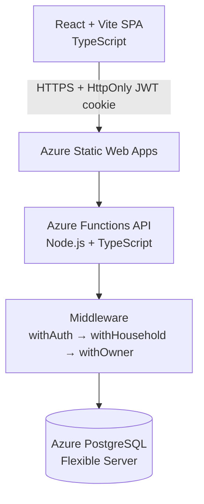

# Bank Balance Tracker

> A full-stack shared household finance app: accounts, balance history, transactions, and CSV import.
> Source is private. Happy to walk through it in an interview.

## The problem

<!-- DRAFT: rewrite in your own words -->
Bank apps show one person's accounts at a time, and spreadsheets drift out of date. I wanted one place where everyone in a household can see every account, record balances and transactions, and see what's actually available after pending (uncleared) items, while keeping each household's data strictly private.

## How it works

- **Frontend:** a React 19 + Vite single-page app with pages for login, dashboard, accounts, and accepting invites, talking to the API through a small typed fetch client.
- **API:** about 27 Azure Functions HTTP endpoints, one per file, with Zod validation on every request body.
- **Auth and access:** composable middleware. `withAuth` verifies the session cookie, `withHousehold` scopes every query to a household the user belongs to, and `withOwner` gates owner-only actions such as invites.
- **Data:** PostgreSQL with versioned SQL migrations. Balances are derived from transactions: current balance is the sum of cleared transactions, available balance is the sum of all.

## Demo

<!-- TODO: add screenshots / images/demo.gif using FAKE demo data only -->

## Key design decisions

- **Serverless Functions + managed Postgres over an always-on server.** The priorities were low operating cost and low maintenance for a small number of users. Static Web Apps with integrated Functions gives free-tier hosting and no servers to patch.
- **JWT in an HttpOnly cookie, not localStorage.** JavaScript can't read the token, which removes a whole class of XSS token theft. bcrypt for password hashing.
- **Household as the security boundary.** Every financial row belongs to a household, and middleware enforces membership before any handler runs, so a missed check in one endpoint can't leak another household's data.
- **Balances derived from transactions.** A manual balance entry creates a balancing transaction instead of overwriting a number, which keeps a full audit trail and makes cleared and available balances fall out naturally.
- **Two-step CSV import (preview, then commit).** Users see parsed rows and duplicates before anything is written; on commit, an auto-reconciled balance snapshot keeps the account in sync.
- **Parameterized SQL over an ORM.** The schema is small and stable; raw `pg` with parameterized queries keeps things transparent and injection-safe.

## Tech stack

React 19 · Vite · TypeScript · react-router · Azure Functions v4 (Node.js 22) · Azure Static Web Apps · Azure Database for PostgreSQL · Zod · bcrypt · JWT

## What I learned / what's next

<!-- DRAFT: rewrite in your own words -->
- Designing the authorization boundary first (household scoping in middleware) made every later endpoint simpler and safer.
- Next: email invites in production, richer balance-history charts, and automated end-to-end tests.
